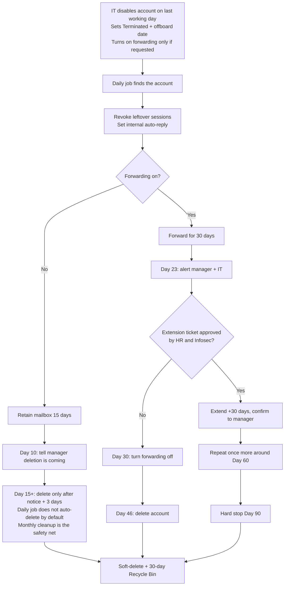

# Employee Exit Email Management Automation

This document explains **what the Email Forwarding (EF) automation does** after an employee has been offboarded, and the steps it follows. It is intended for IT, managers, HR, and Infosec.

It does **not** cover how the service is deployed or how the code is structured.

---

## 1. Purpose

When someone leaves Netradyne, their mailbox still needs a defined life: either a short hold with no access, or a time-limited forward to their manager, then removal.

This automation takes over **after** IT has already disabled the account and (if requested) turned on email forwarding. From that point it:

- Finds terminated, disabled accounts that have an offboard date
- Sets an internal out-of-office reply and revokes leftover sign-in sessions
- Tracks each mailbox against the Employee Exit Email Management & Access Policy
- Reminds managers before forwarding expires, and before a no-access mailbox is deleted
- Turns forwarding off, then deletes the account, on the policy schedule
- Applies approved extensions (up to 90 days from the offboard date)
- Sends weekly and monthly summaries to the operations team

**No-show / never-started accounts are not handled here.** Those people never received mailbox access, so IT deletes them manually.

---

## 2. What this automation does *not* do

The following stay with people, not the job:

| Still manual | Who |
|---|---|
| Create or decline the initial forwarding request | Manager + IT |
| Raise a ServiceDesk ticket to extend forwarding | Manager |
| Approve or reject that ticket | HR and Infosec |
| Apply the extension in Entra after both approvals | IT |
| Delete accounts outside India | IT |
| Delete accounts on legal hold or marked exempt | IT / Legal |

---

## 3. Who the automation picks up

Every day it looks in Entra ID for people who match **all** of these:

1. `employeeType` is **Terminated**
2. The account is **disabled** (sign-in blocked)
3. An **offboard date** is stored on the user (`extensionAttribute10`)
4. The account’s **usage location is India** (`IN`)

If any of those is missing, the account is left alone.

Days in this document are counted from that offboard date (Day 0 = last working day / official exit date).

---

## 4. What happens the first time a person is seen

As soon as a matching account appears, the automation records them and does three one-time actions:

1. **Revokes active sign-in sessions** so leftover Outlook / mobile sessions cannot keep using the mailbox.
2. **Turns on an internal-only auto-reply** (external senders do not get a reply).
3. **Checks whether email forwarding is already on** the mailbox and chooses one of the two paths below.

The auto-reply stays on for **30 days**, then is turned off.

### Auto-reply wording

**If forwarding is on**

> Thank you for your email. This mailbox is no longer monitored as the individual is no longer associated with Netradyne. Your message has been automatically forwarded to the employee's manager, *Name at email*, for further review and action.

**If forwarding is not on**

> Thank you for your email. This mailbox is no longer monitored as the individual is no longer associated with Netradyne. For business-related matters, please contact *Name at email*.

The manager is read from Entra while the manager relationship still exists, which is before the account is deleted.

If forwarding is added later (for example after a late business request), the tracking record switches from the “no forwarding” path to the “forwarding” path on the next daily run.

---

## 5. The two paths

```
Terminated + disabled + offboard date (India)
                    │
                    ▼
         Is email forwarding on?
           /                  \
         No                    Yes
          │                     │
   Path A – No access    Path B – Manager forwarding
   15-day retention      30 / 60 / 90-day lifecycle
```

---

## 6. Path A — No email forwarding (no access requested)

Used when nobody asked for mailbox access or a forward during offboarding.

| Day from offboard | What happens |
|---|---|
| **0** | Account is registered. Sessions revoked. Internal auto-reply set. Mailbox is retained. |
| **10** | Pre-deletion notice is emailed to the manager (or IT admins if no manager is on file). They are told the mailbox will be deleted at Day 15 and can still raise a ServiceDesk request. |
| **15** | Mailbox is eligible for deletion **only if** the pre-deletion notice was sent **and** at least **3 days** have passed since that notice. |

If a manager still needs access after Day 10, they must raise a ServiceDesk request immediately. If IT then enables forwarding, the account moves to Path B.

### How deletion actually happens on Path A

The daily job **does not auto-delete** these mailboxes by default. IT can delete them during offboarding. If that is missed, the **monthly cleanup** (1st of the month) is the safety net: it finds leftover no-forwarding accounts that are at least 15 days past offboard, confirms the pre-deletion notice and 3-day lead time, then deletes them.

If the notice has not gone out yet, cleanup **sends the notice and waits** until the next run. It will not delete a silent mailbox.

---

## 7. Path B — Email forwarding is on (Workflow B)

Used when the manager already has forwarding. Policy allows forwarding for **30 days**, then up to **two 30-day extensions**, hard stop at **90 days** from the offboard date.

HR and Infosec each have a **2 business-day** SLA to review an extension ticket. Alerts are sent early enough for that review to finish before forwarding is removed.

### Timeline (no extension)

| Day | What the automation does |
|---|---|
| **0** | Registers the account, revokes sessions, sets the “forwarded to manager” auto-reply. |
| **23–29** | Sends the first expiration alert to the manager (IT is copied). Tells them to raise a ServiceDesk ticket if they still need the mailbox. Also emails IT an Approve / Decline link. |
| **30** | Turns **forwarding off**. The account is **not** deleted yet. Manager is told how many days remain before deletion. |
| **30–45** | Grace window. If a late extension is approved here, forwarding is turned back on automatically. |
| **46** | Account is deleted if no extension was applied. |

### Timeline (first extension approved)

| Day | What happens |
|---|---|
| After approval | Forwarding continues (or is turned back on). Manager gets a confirmation email. New target is Day 60. |
| **53–59** | Second alert — same ticket process. |
| **60** | Forwarding turned off again unless a second extension is already approved. |
| **60–75** | Second grace window for a late approval. |
| **76** | Account is deleted if the second extension was not applied. |

### Timeline (second / final extension)

| Day | What happens |
|---|---|
| After second approval | Forwarding continues until Day 90. Status is marked as maximum policy. |
| **83–89** | **Final** alert. No further extension is possible. |
| **90** | Account is deleted. There is no grace period after Day 90. |

### How an extension is approved

```
Manager receives alert
        │
        ▼
Raises ServiceDesk ticket
(justification + duration, max 30 days)
        │
        ▼
HR reviews  ──reject──►  forwarding ends on the published date
        │
      approve
        ▼
Infosec reviews  ──reject──►  forwarding ends on the published date
        │
      approve
        ▼
IT records the approval on the user in Entra
(EFAutomation.ExtStatus = EXTEND_TO_30 / EXTEND_TO_60 / EXTENDED_MAX,
 plus the ServiceDesk ticket number)
        │
        ▼
Next daily run applies the extension, clears the flag,
re-enables forwarding if it was already off,
and emails the manager a confirmation
```

IT can apply the Entra flag in the portal, **or** use the Approve link in the IT approval email (ticket number is captured on that form). Decline logs the refusal; the published deletion date still applies.

Each extension can be granted **once**. A third attempt is ignored. Maximum from offboard date is **90 days**.

---

## 8. What “delete” means

When the automation deletes an account it:

1. Checks it is still allowed to delete (see safety rules below)
2. Soft-deletes the Entra / Microsoft 365 account (Recycle Bin)
3. Emails the manager (and IT) that the account is gone — the monthly cleanup does this too
4. Marks the person as deleted in the tracking record, with **when**, **why** and **who** (automation / cleanup / manual)

Microsoft 365 licenses are released by Entra automatically when the account is deleted.

### Accounts IT deletes by hand

Every daily run also checks tracked people who have dropped out of the "terminated + disabled" list. If Entra's recycle bin has them, IT deleted them outside the automation, so the tracking record is marked deleted (**Deleted by: manual**) using the recycle-bin deletion date. Nothing is changed in Entra by this check.

The mailbox can still be **recovered from Microsoft 365 for about 30 days** after deletion. After that it is gone.

---

## 9. Safety rules — when the automation will *not* delete

Any one of these stops an automated delete:

| Rule | Why |
|---|---|
| Usage location is not India | Non-India accounts are out of scope; IT handles them. |
| Litigation / in-place hold is on | Legal must manage the mailbox. |
| Entra flag `EFAutomation.DeleteExempt` is set | Operational hold (investigation, dispute, special case). |
| The person is on an IT exemption list | Same idea, maintained by IT. |
| Pre-deletion notice has not been sent, or the 3-day lead has not passed | Policy 4.6.2 — no silent deletion of no-access mailboxes. |
| The mailbox still has forwarding (cleanup only) | That account belongs on Path B, not the cleanup job. |
| UAT / “do not delete accounts” is on | Used while the team is validating the process. |

Those accounts stay in the reports so they are not forgotten.

---

## 10. Emails the automation sends

| Email | Who receives it | When |
|---|---|---|
| Forwarding expiration alert | Manager, IT copied | Days 23, 53, and (final) 83 |
| IT Approve / Decline | IT approval mailbox | Same time as each alert |
| Forwarding disabled | Manager, IT copied | Day 30 or 60, if no extension |
| Extension confirmed | Manager, IT copied | After IT records an approved extension |
| Pre-deletion notice (no forwarding) | Manager, or IT admins if no manager | Day 10 (or earlier if deletion is already due) |
| Account deleted | Manager, IT copied | When the account is removed |
| Final deletion (90-day cap) | Manager, IT copied | Day 90 |
| Weekly offboard report | Report mailbox | Every Monday |
| Monthly offboard report | Report mailbox | 1st of the month |

A typical alert tells the manager: employee name and mailbox, offboard date, when forwarding expires, and a button to raise the ServiceDesk extension request. The final alert states that no further extension is possible.

---

## 11. Weekly and monthly reports

Operations receive a consolidated report covering:

- Newly tracked leavers **with** forwarding (includes who mail is forwarded to)
- Newly tracked leavers **without** forwarding
- No-forwarding accounts still present after Day 10 (overdue for attention)
- **Accounts deleted in the period** — name, mailbox, offboard date, deleted on, deleted by (automation / cleanup / manual), reason, and the **recoverable until** date (deleted on + 30 days)
- Counts of alerts, extensions, and deletions in the period

The same report is also archived to the IT SharePoint reports folder (Excel / CSV, including a **Deleted** sheet) so there is a lasting copy.

---

## 12. Monthly cleanup (safety net)

On the **1st of each month** a second job looks for leftover India accounts that should already be gone:

1. Tracked people **without** forwarding who are 15+ days past offboard and still active
2. Terminated + disabled India accounts that the daily job never picked up (for example `employeeType` was never set to Terminated in time)

Cleanup will not delete if forwarding is on, if the account is exempt or on hold, or if the manager has not yet been given the 3-day pre-deletion notice.

---

## 13. End-to-end picture



---

## 14. Roles at a glance

| Role | What they do in this process |
|---|---|
| **IT (offboarding)** | Disable the account, set Terminated + offboard date, enable forwarding only when a request exists. |
| **Automation** | Track timelines, set auto-reply, revoke sessions, send notices, disable forwarding, delete when due, produce reports. |
| **Manager** | Raise a ServiceDesk ticket if they still need the mailbox after the first 30 days, or if they need access to a no-forwarding mailbox before Day 15. |
| **HR / Infosec** | Approve or reject the extension ticket (2 business days each). |
| **IT (operations)** | Apply the approved extension in Entra (or use the email Approve link). Handle no-shows, non-India, legal hold, and exempt cases by hand. |

---

## 15. Policy numbers currently in use

These are the values the live process is running with. They can be changed by IT without rewriting the process.

| Item | Value |
|---|---|
| Region in scope | India only |
| No-forwarding retention | 15 days |
| Pre-deletion notice | Day 10 |
| Minimum notice before delete | 3 days |
| Auto-reply duration | 30 days |
| First forwarding period | 30 days |
| First / second / final alerts | Days 23 / 53 / 83 |
| Forwarding turned off (if no extension) | Days 30 / 60 |
| Account deleted after grace (if no extension) | Days 46 / 76 |
| Absolute maximum | Day 90 |
| Recycle Bin recovery | ~30 days after delete |
| Daily run | 09:00 UTC |
| Weekly report | Monday |
| Monthly report and cleanup | 1st of the month |
| No-show accounts | Manual — not in this automation |
